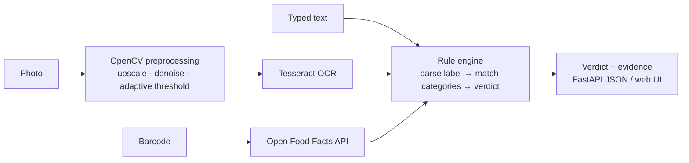

# AllergenCheck

Check a food label against your allergies and diet before you eat. You can photograph the ingredient list, scan a barcode, or paste the text. You get a clear verdict, and every flag points at the exact words on the label that caused it.


| Verdict | Meaning |
|---|---|
| **Don't eat** | An ingredient or the "Contains" statement matches something you avoid |
| **Check first** | Only a cross-contact warning ("may contain…") matched, or an ingredient has an unclear source (e.g. "natural flavors") |
| **Looks OK** | Nothing on the label matched your profile |
| **Can't tell** | No ingredient list could be read. Retake the photo or type it in |

## Why the verdict is rule-based, not an LLM

The first version of this project sent the OCR text to an LLM and asked "is this safe for me?". For an allergy tool, that isn't acceptable: the answer can change from one run to the next, can miss an ingredient, and can't show its reasoning. In version 2, a **deterministic engine** decides the verdict:

- **The 9 major US allergens** (milk, egg, fish, crustacean shellfish, tree nuts, peanuts, wheat, soy, sesame) plus diets (gluten, red meat, vegetarian), each with label synonyms: *whey* and *casein* → milk, *semolina* and *spelt* → wheat, *tahini* → sesame, and so on.
- **Look-alike guards** stop false alarms: *nutmeg*, *butternut* and *coconut* aren't tree nuts, *cocoa butter* and *oat milk* aren't dairy, *buckwheat* and *rice flour* aren't wheat, and "peanut-free" isn't peanut.
- **Label structure:** the ingredient list, the "Contains:" statement and "may contain / made in a facility with" warnings are read separately, because they mean different things.
- **OCR tolerance:** common OCR mistakes (`mi1k`, `pean0ts`, `almomds`) are repaired by edit distance. Real words that sit one letter away from an allergen (*mustard* vs *custard*, *button* vs *mutton*) are never "corrected". Corrected matches are labeled so you can double-check them.
- Plain **"flour"** counts as wheat, because that's what it means on a US label.

## Architecture



- **API:** FastAPI. Photos are processed in memory, so nothing is written to disk. Uploads are checked for type (JPEG/PNG/WebP/HEIC) and size (6 MB). Every response carries an `X-Request-ID` and is logged with its latency.
- **Profiles:** structured (`{"avoid": ["peanut", "milk"], "custom": ["kiwi"]}`) instead of a free-text file. The web UI saves yours on your device.
- **Barcodes:** looked up in [Open Food Facts](https://world.openfoodfacts.org/), a free community database. Its allergen and trace tags are added to the label text, so the same engine checks them.

## Run it

```bash
docker build -t allergencheck .
docker run -p 8000:8000 allergencheck
# open http://localhost:8000
```

Without Docker: install [Tesseract](https://tesseract-ocr.github.io/tessdoc/Installation.html) (`brew install tesseract` on macOS), then:

```bash
pip install -r requirements.txt
uvicorn allergencheck.api:app --reload
```

## API

```bash
curl -X POST localhost:8000/api/analyze/text -H 'Content-Type: application/json' \
  -d '{"text": "Ingredients: sugar, whey, peanuts. May contain almonds.", "profile": {"avoid": ["peanut", "tree_nut"]}}'

curl -F image=@label.jpg -F 'profile={"avoid":["milk"]}' localhost:8000/api/analyze/photo

curl 'localhost:8000/api/analyze/barcode/3017620422003?avoid=milk,tree_nut'
```

`GET /api/categories` lists every category key. Interactive docs are at `/docs`.

## Tests

```bash
pip install -r requirements-dev.txt
pytest
```

- **38 tests:** engine verdicts, look-alike guards, OCR-noise repair, label structure, the API (validation, uploads, request IDs), barcode lookup against a mocked Open Food Facts, and **real OCR** on a rendered label image.
- **CI** on every push installs Tesseract, runs `ruff` and the full suite, then builds the Docker image and smoke-tests the running container.

## Limitations

- English labels only, and the US allergen list.
- OCR needs a reasonably sharp, flat photo of the ingredient panel. Curved or glossy packaging can still fail, and then the app answers *Can't tell* instead of guessing.
- This is a screening aid, not medical advice. Formulations change, so for severe allergies always read the package itself.

## License

MIT
