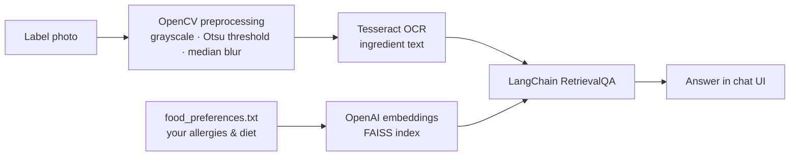

# Food Allergen Detection

Upload a photo of a food label and ask whether it's safe for you to eat. The app reads the ingredient list with OCR, then answers with a retrieval-augmented LLM that is grounded in your own dietary preferences and allergies.

  

## How it works



1. **Preprocess.** OpenCV converts the photo to grayscale, applies Otsu thresholding and a median blur so that OCR reads small print on curved packaging.
2. **Extract.** Tesseract pulls the ingredient text from the cleaned image.
3. **Retrieve.** Your preferences file is chunked, embedded with OpenAI embeddings and indexed in FAISS when the server starts.
4. **Answer.** A LangChain `RetrievalQA` chain asks the LLM whether the extracted ingredients are safe *for you*, using the retrieved preferences as context.

## Tech stack

| Layer | Tools |
|---|---|
| Backend | Python, Flask, Flask-CORS |
| Vision / OCR | OpenCV, Tesseract (pytesseract) |
| RAG | LangChain, FAISS, OpenAI embeddings + LLM |
| Frontend | HTML, CSS, JavaScript chat interface |

## Run it locally

**Requirements:** Python 3.10+, the [Tesseract OCR binary](https://tesseract-ocr.github.io/tessdoc/Installation.html), and an OpenAI API key.

```bash
git clone https://github.com/ArunaSamhitha/Food-Allergen-Detection-System.git
cd Food-Allergen-Detection-System
pip install -r requirements.txt
echo "OPENAI_API_KEY=your-key-here" > .env
python app.py            # serves the API on http://localhost:8000
```

Open `index.html` in a browser, upload a label photo and ask a question. You can also call the API directly:

```bash
curl -F "image=@label.jpg" http://localhost:8000/analyze_image
```

Edit `food_preferences.txt` to describe your own allergies and diet. The index rebuilds on the next start.

## Limitations and next steps

- OCR accuracy drops on glossy or heavily curved packaging. A vision-language model could read labels directly.
- Safety answers come from the LLM. A deterministic check against a list of the major allergens would make results auditable.
- Uploads are written to a single temp file, so concurrent requests can collide. Per-request temp files would fix this.

## License

MIT
